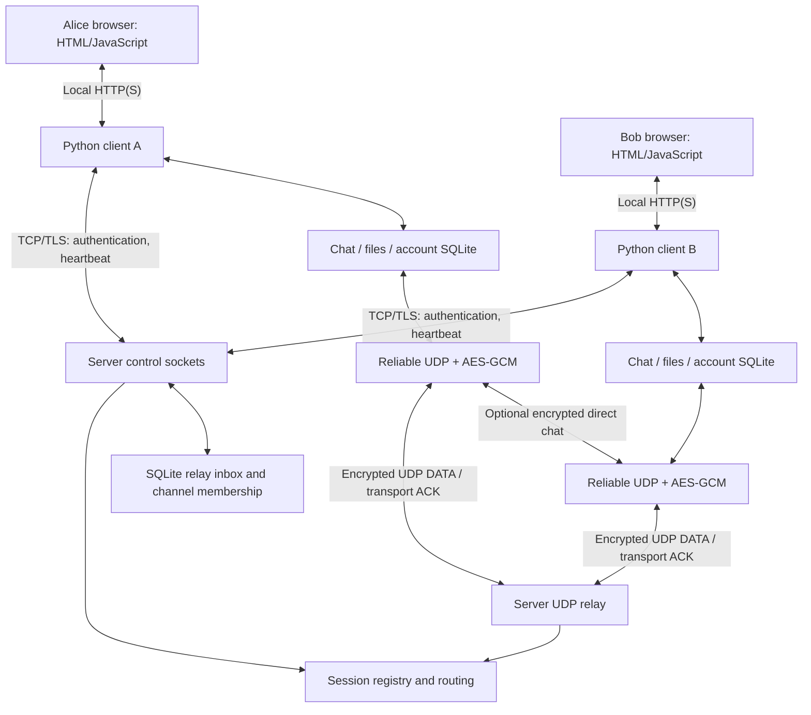

# System architecture

The application separates transport, application messages and browser interaction.
The server coordinates sessions and relays messages; every browser talks to its
own Python client through a localhost HTTP(S) adapter.

## Module boundaries

| Path | Responsibility |
|---|---|
| `app/common/` | Shared configuration, frame encoding and message validation |
| `app/server/` | Account authentication, connected-user registry and message/file relay |
| `app/transport/` | Per-stream ordering, authenticated ACK/retry, receiver credit and bounded AIMD |
| `app/features/` | Chat validation, streaming files/hash checks, RAM demo state and SQLite account state |
| `app/security/` | AES-GCM, privately supplied shared key and direct-peer HMAC capabilities |
| `app/client.py` | TCP/TLS session, UDP events, heartbeat and recipient acknowledgments |
| `app/web/` | Local raw-socket HTTP(S) adapter, login lifecycle and browser HTML/JavaScript |

## Connection and data lifecycle

1. Register uses a separate verified TLS connection in account mode. Login opens
   TCP/TLS, exchanges `HELLO`/`HELLO_OK`, and submits username and UDP endpoint.
   Account mode also verifies the password against the persistent PBKDF2 store.
2. The server creates a random session token, registers the user and returns the
   online roster. Fresh sessions derive independent chat and application-ACK streams.
3. The client commits outgoing chat before sending encrypted UDP DATA. The relay
   validates sender/token/endpoint and persists immutable chat with recipient ACKs.
   An authenticated TLS `GET_PEERS` response may enable direct UDP chat, with
   session-pair proofs and relay fallback. Files continue through the server.
4. ReliableUDP orders each stream independently, retransmits missing ACKs and
   suppresses transport duplicates. File streams do not share chat ordering state.
5. An account recipient commits chat once by owner/sender/message UUID, then sends
   an application acknowledgment. Every target must confirm before DELIVERED.
   Pending offline relay messages synchronize in batches over verified TLS control;
   live relays and file chunks use UDP. Stored content hashes reject changed-body retries.
6. File receivers write `.part` data, check size/chunk order and SHA-256, then
   publish the completed file and send `FILE_RECEIPT`. Failed partial files are cleaned up.
7. TCP heartbeats maintain the session; EOF, expiry or Logout revoke its token and
   update the roster. Logout clears session events but leaves the local UI available.
8. Account outbox/inbox survive process and server restarts through local SQLite
   databases. Fresh authentication binds the owner's state and resets interrupted
   SENDING items to PENDING. Network loss permits offline composition to known
   contacts. Explicit logout clears the current UI/cookie, retaining pending disk
   state for its owner. Demo state is RAM-only and reconnects automatically.

## Flow control and concurrency

Each (peer, stream) starts with congestion window 1 and one initial credit. A
verified ACK advertises free capacity, accounting for active, queued and reordered
packets. Default capacity is 16 per receive stream. In-flight sends are limited by
the configured maximum 4, integer congestion window and receiver credit.
Clean ACKs increase the window by 1/cwnd; network timeout halves it, with floor 1.
At zero credit, the sender waits and probes using an unchanged accepted frame;
deduplication prevents another application delivery. Backpressure has a separate
10-second deadline and does not consume network retries or halve the window.

Chat and files use separate ordered streams, so a missing file chunk does not
block chat. A lost packet can still block later packets within its own stream
until retry/recovery. TCP control connections use per-client workers; each active
UDP receive stream has an ordered worker that retires when idle. The local HTTP
adapter caps concurrent workers at 32, and client control requests are bounded at
32. Socket I/O, retry loops and SQLite lock waits have timeouts.

## Local persistence and browser sessions

`DurableChatState` partitions `local_chat` rows by authenticated owner. It limits
pending outbox entries to 500 and loads the latest 500 history rows. The server's
`RelayChatStore` keeps message bodies, recipient confirmations and channel members;
pending relay messages are capped at 500 per sender, with synchronization batches
of four. Channel membership is limited to eight per user and 64 members per channel.
Stored history/dedup records have no automatic disk retention policy.

Account-mode HTTP state and mutations require a random Secure, HttpOnly,
SameSite=Strict cookie named for the UI's actual port. Logout revokes it; stale
poll responses cannot restore a previous account's DOM. Passwords are not retained.
Authentication gets a 15-second network timeout; normal control polling uses one
second. Server PBKDF2-SHA256 retains 600,000 iterations.

## Design boundaries

- Default server ports are TCP **9100** and UDP **9101**. Each local browser adapter
  binds only to **127.0.0.1**; account mode requires verified TLS and local HTTPS.
- The TCP control / UDP live-data split follows the reliable UDP file-transfer rubric.
  Packet layouts and message sequences are in [protocol.md](protocol.md).
- Congestion control is tested AIMD, accepted by the supplied lecturer clarification;
  it does not implement BBR, CUBIC, bandwidth estimation or adaptive pacing.
- AES-GCM uses a shared test key for UDP hops. Pair capabilities add direct-peer
  sender authentication but do not provide production key exchange or E2E secrecy.
- SQLite files are plaintext local profile data. OS file access can bypass application
  account partitioning. Files resume by restarting a transfer, not partial-file continuation.
- There is no database server, cloud service, web framework or WebSocket layer.
