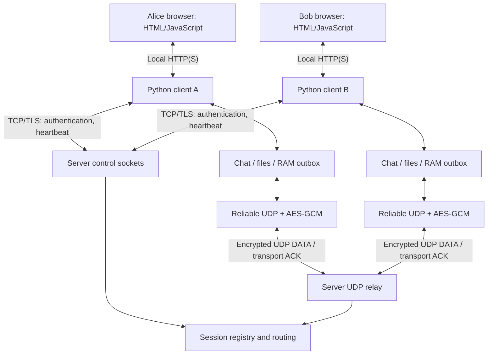

# System architecture

The application separates transport, application messages and browser interaction.
The server coordinates sessions and relays messages; every browser talks to its
own Python client through a localhost HTTP(S) adapter.

## Module boundaries

| Path | Responsibility |
|---|---|
| `app/common/` | Shared configuration, frame encoding and message validation |
| `app/server/` | Account authentication, connected-user registry and message/file relay |
| `app/transport/` | Per-stream ordering, ACK/retry, duplicate suppression and fixed window |
| `app/features/` | Chat validation, streaming file chunks, reassembly/hash checks and RAM outbox |
| `app/security/` | AES-GCM encryption and privately supplied shared key |
| `app/client.py` | TCP/TLS session, UDP events, heartbeat and recipient acknowledgments |
| `app/web/` | Local raw-socket HTTP(S) adapter, login lifecycle and browser HTML/JavaScript |

## Connection and data lifecycle

1. Register uses a separate verified TLS connection in account mode. Login opens
   TCP/TLS, exchanges `HELLO`/`HELLO_OK`, and submits username and UDP endpoint.
   Account mode also verifies the password against the persistent PBKDF2 store.
2. The server creates a random session token, registers the user and returns the
   online roster. Fresh sessions derive independent chat and application-ACK streams.
3. The client sends encrypted UDP chat/file DATA. The server validates the sender,
   token and source endpoint before forwarding to authenticated recipients.
4. ReliableUDP orders each stream independently, retransmits missing ACKs and
   suppresses transport duplicates. File streams do not share chat ordering state.
5. A recipient accepts chat once by sender/message UUID and sends an encrypted
   application acknowledgment. Only the corresponding receipt marks it DELIVERED.
6. File receivers write `.part` data, check size/chunk order and SHA-256, then
   publish the completed file and send `FILE_RECEIPT`. Failed partial files are cleaned up.
7. TCP heartbeats maintain the session; EOF, expiry or Logout revoke its token and
   update the roster. Logout clears session events but leaves the local UI available.
8. Pending chats remain private to their account in the running local process.
   Demo mode reconnects automatically; account mode requires a fresh login before
   ordered replay. Closing the client process discards RAM state.

## Design boundaries

- Default server ports are TCP **9100** and UDP **9101**. Each local browser adapter
  binds only to **127.0.0.1**; account mode requires verified TLS and local HTTPS.
- The TCP control / UDP data split follows the reliable UDP file-transfer rubric.
  Packet layouts and message sequences are in [protocol.md](protocol.md).
- The fixed four-packet window limits outstanding frames; it does not implement
  adaptive pacing, BBR or CUBIC congestion control.
- AES-GCM uses a shared test key for UDP hops. There is no production key exchange,
  durable outbox, database, cloud service, networking framework or WebSocket layer.
