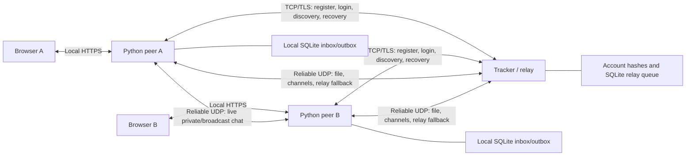

# System architecture

- The Python peer owns TCP sessions, UDP streams, inbox/outbox and file state.
  Its browser talks to a localhost HTTP(S) adapter. Secure mode authenticates
  browser API calls using a session cookie. Linux can run that adapter over the
  user-space TCP listener for the raw TCP experiment.
- The tracker authenticates accounts, stores online endpoints and issues
  capabilities for pairs of active sessions. It retains relay and channel
  messages with per-recipient acknowledgement state for reconnect.
- UDP supplies sequence numbers, authenticated acknowledgements, retry, bounded
  receive credit and per-stream AIMD. Chat and files advance independently.
- The recipient commits a chat before emitting its application receipt.
  File delivery closes after the recipient validates the size and SHA-256.
  Interrupted files are aborted and their partial paths removed.
- Chat and file payloads use AES-GCM with a separately supplied lab key.
  Direct messages also carry a session-pair proof. TLS protects passwords,
  session tokens, recovery batches and pair capabilities. SQLite holds message
  content on the respective machine, so deployment should restrict access to
  those local files.

See the [protocol specification](protocol.md) for frame and stream details.
