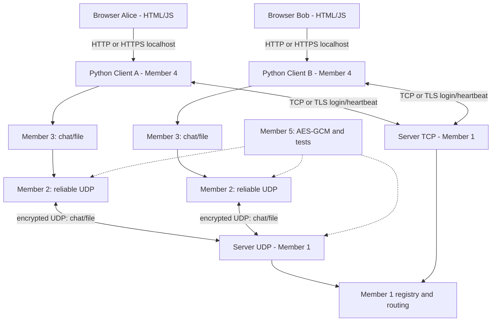

# Architecture (baseline)

## Data path

1. Browser Login creates a network client. It opens TCP (verified TLS for accounts),
   exchanges `HELLO`/`HELLO_OK`, then sends `LOGIN` with username and its UDP port.
2. Member 1 checks username (and PBKDF2 password in account mode), creates a random session token and returns `LOGIN_OK`.
3. Client A sends chat/file application messages through Member 2 encrypted UDP transport.
4. Server validates sender, session token and UDP source IP/port before forwarding.
5. Recipient Member 2 delivers the data stream in order to Member 3; Member 3 displays chat or rebuilds file.
6. Recipient checks the SHA-256 after receiving file and sends `FILE_RECEIPT` to sender via server.
7. Client sends TCP PING every 3 seconds. Server removes disconnected users after timeout.
8. Logout closes the network session and clears RAM events and browser history.
   The local web listener stays running; another login creates a new client/token.
   Account mode also requires HTTPS between browser and the local adapter.

## Design decisions

- UDP data path is kept distinct from the TCP control path to satisfy contradictory
  statements in the assignment without pretending TCP transfer fulfills UDP rubric.
- One UDP stream per file (UUID), one shared chat/control stream per peer. This keeps
  chat and file delivery state separate. Each stream has an ordered delivery queue.
- UI communicates only with a **local** Python process: browsers cannot directly
  send the raw UDP packets used by this project.
- The app is self-hosted on localhost or LAN; no cloud, database, framework or WebSocket.
