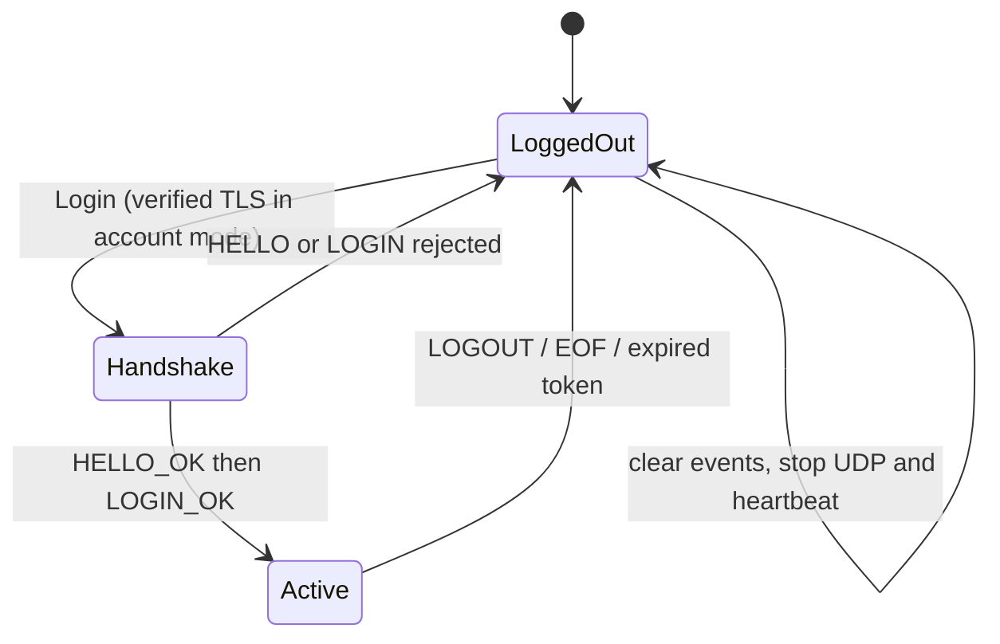
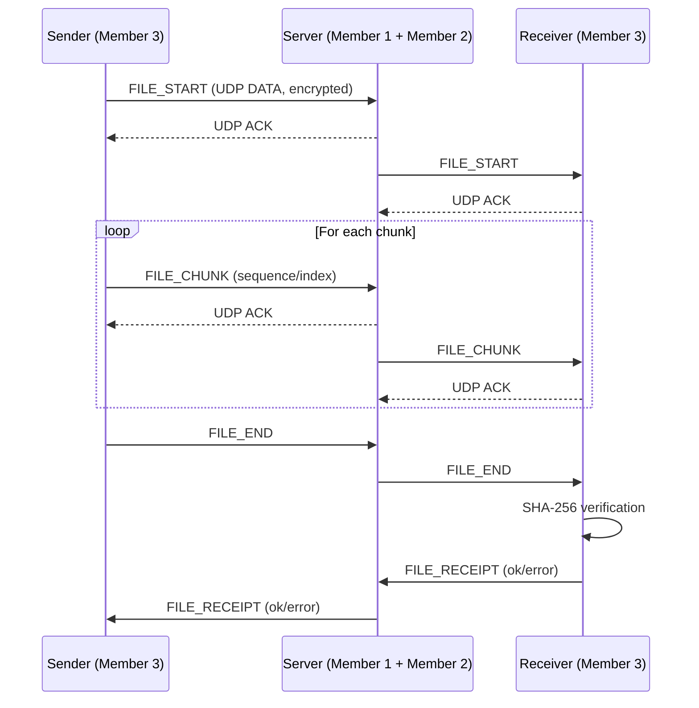
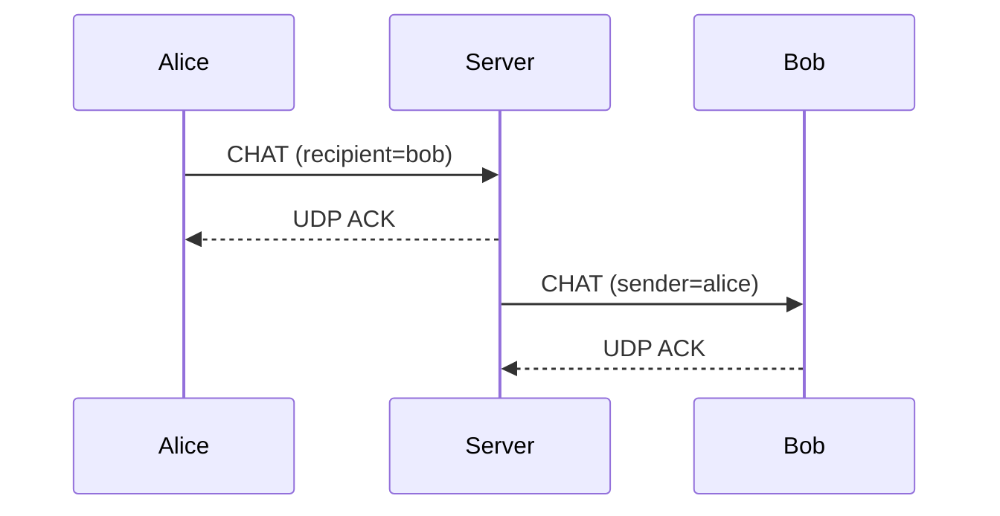

# Protocol specification (version 1)

**Do not modify this contract without team review.** Member 1 + Member 2 own protocol updates.

## 1. TCP control (one JSON object + `\n` per message)

Client -> server:

```json
{"type":"HELLO","version":1}
{"type":"LOGIN","username":"alice","udp_port":54321}
```

Server -> client:

```json
{"type":"LOGIN_OK","token":"<random-session-token>","users":["alice","bob"],"version":2,"udp_port":9101}
```

HELLO receives `HELLO_OK`; then LOGIN is sent. In account mode the connection
uses verified TLS and LOGIN includes `password` (never persist it). Rejections
include `LOGIN_FAIL`, `LOGIN_LOCKED` or `ERROR`. Demo mode also accepts the
legacy LOGIN-first handshake, but never accepts a password. Other control
messages include `PING`, `GET_USERS`, `LOGOUT`, `AUTH_REQUIRED`, and `ERROR`. TCP uses newline-delimited
JSON framing because `recv()` alone does not preserve message boundaries.
One active session per username. Account records store salted PBKDF2-SHA256
hashes; account mode requires a server TLS context. Expired sessions require
re-authentication. LOGOUT/TCP EOF revokes the token and updates the roster.
The client closes its network session and clears events; relogin uses a new
client/token while the local HTTP(S) listener remains available.



## 2. UDP frame bytes

| Field | Bytes | Meaning |
|---|---:|---|
| Magic `COLB` | 4 | Protocol recognition |
| Version | 1 | `1` |
| Kind | 1 | `1=DATA`, `2=ACK` |
| Sequence | 4 | Big endian unsigned integer, starts at 0 per (peer,stream) |
| Packet ID | 16 | UUID; ACK references exactly this packet |
| Stream ID | 16 | UUID; chat uses constant `...0001`; file uses file UUID |
| Payload | variable | For DATA: 12-byte nonce + AES-GCM ciphertext (includes 16-byte authentication tag) |

Header size: **42 bytes**. Maximum UDP datagram: **1200 bytes**.
ACK datagram contains only the 42-byte header and is NOT encrypted; it has no
application payload. The AES-GCM associated authenticated data (AAD) is the header.

The encrypted application message contains:

```
[2-byte metadata JSON length][UTF-8 JSON metadata][optional raw file bytes]
```

Only file chunks have raw binary data; no base64 expansion inside messages.
All UDP DATA payloads are encrypted and authenticated by the shared AES-GCM key.
A new 12-byte random nonce is generated per DATA frame. Reusing a nonce with
same key is dangerous; do not change this design without Member 5 review.

## 3. UDP application message types

| Type | Required fields | Meaning |
|---|---|---|
| `USERS` | `users, version` | Server updates online usernames (monotonic version avoids stale updates) |
| `CHAT` | `sender, recipient, text` | Broadcast if `recipient="*"`, otherwise private |
| `CHAT_RECEIPT` | `recipients, message` | Recipient transports acknowledged routing; not a read receipt |
| `FILE_START` | `file_id, sender, recipient, name, size, total_chunks, chunk_size, sha256` | Announce file and expected hash |
| `FILE_CHUNK` | `file_id, sender, recipient, index, data` | Binary file chunk, starts at index 0 |
| `FILE_END` | `file_id, sender, recipient` | File transmission finished |
| `FILE_RECEIPT` | `file_id, sender, status, message` | Receiver confirms complete hash check or error |
| `FILE_ABORT` | `file_id, message` | Server cancels interrupted/expired transfer; remove only its partial file |
| `ERROR` | `message` | Application error response |

Client -> server messages add `token` containing the authenticated session token.
Server -> client messages intentionally omit token. `data` is a Python `bytes`
field that becomes the raw byte suffix of the encrypted application message.
A file stream uses the file's `file_id` as its Stream ID.

## 4. Transport API (Member 2, already callable)

```python
transport = ReliableUDP(bind_host, bind_port, key, on_message)
transport.send((host, udp_port), message_dict, stream_id)
transport.send_many((host, udp_port), iterable_of_dicts, stream_id, on_progress=callback)
transport.close()
```

- `on_message(peer_address, stream_uuid, message_dict)` is a callback.
- `on_progress(acknowledged_packet_count)` reports UDP **hop-level** ACKs.
- Each stream delivers its messages in order (not an infinite globally ordered stream).
- Retransmissions are for packets missing ACKs; duplicated packets do not redeliver.
- Producers on the same (peer, stream) are serialized; different streams remain
  independent. An oversized event is rejected before consuming a sequence.
- On retry exhaustion, raise TimeoutError and retain at most one window of
  outstanding frames. The next call retransmits those exact frames with the same
  UUIDs/sequences before its new frames, filling any receiver gap. Neither side
  resets sequence counters. ACK loss may mean the failed call already delivered;
  timeout is an uncertain result. Close discards the transport's pending state.
- DATA is queued in order before sending its ACK, so an ACK send error cannot
  discard accepted data. ACKs must match the expected peer, packet, stream and
  sequence, with no payload. They remain unencrypted and are not a security proof.
- **Important:** File checksum verification + FILE_RECEIPT is the end-to-end proof,
  not UDP ACK (which only says a packet arrived at the next transport hop).

## 5. Member 3 API (already implemented)

```python
ChatService.build_message(sender, recipient, text)  # -> dict
ChatService.recipients(sender, recipient, online_usernames)  # -> list[str]
FileSender().prepare(path, sender, recipient, display_name=None)
# -> (file_uuid_string, total_udp_packets, generator_of_messages)
receiver = FileReceiver(download_dir)
receiver.process(message_dict)  # -> progress / complete event / None
receiver.close()
```

Default file chunk size = **800 bytes** (`chunk_size` included in FILE_START), intentionally well below the typical
IP MTU once headers and encryption are included. File chunks are transferred
sequentially within a file stream, with a **fixed window of 4 UDP packets**.

## 6. File transfer sequence

The server tracks both participant session tokens and last relay activity until
FILE_RECEIPT. A disconnect, changed session, relay error or 60-second inactivity
removes metadata and sends FILE_ABORT to remaining original sessions. Cleanup
checks/removals share the transfer lock; no network send occurs under that lock.
The receiver serializes writes/abort/timeout/close under its file lock. Only
`.part` files owned by this receiver are removed; verified destinations survive.



## 7. Chat routing sequence



## 8. Pending teacher confirmation

1. Does the TCP handshake + UDP streaming split satisfy both TCP and UDP wording?
2. Is the local HTTP + client-side JS solution acceptable for Step 9?
3. Is a fixed sliding window sufficient, or must congestion control actually
   implement BBR/CUBIC? **Current version does not implement BBR/CUBIC.**
4. Is the five-person group and revised deadline confirmed?
