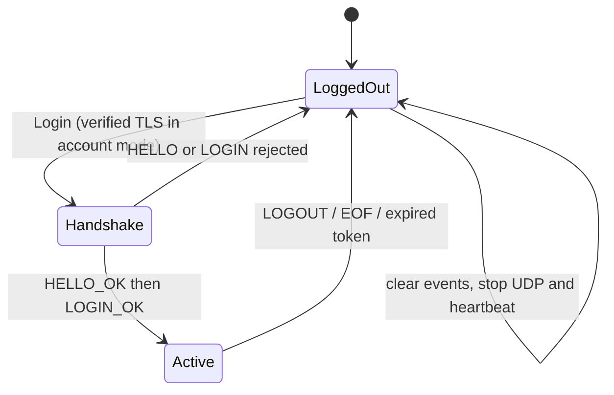
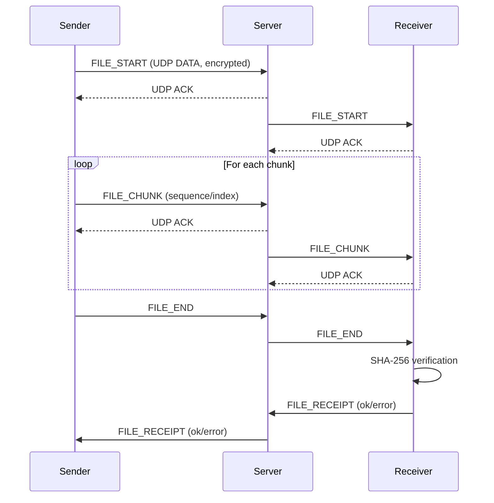
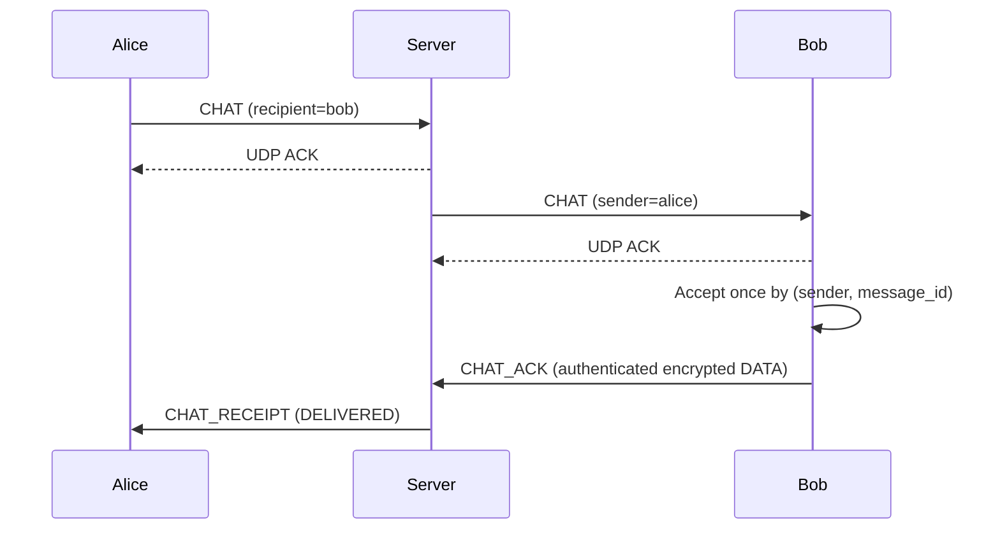

# Protocol specification (version 1)

The control and UDP message contracts below describe the submitted implementation.

## 1. TCP control (one JSON object + `\n` per message)

Client -> server:

```json
{"type":"HELLO","version":1}
{"type":"LOGIN","username":"alice","udp_port":54321}
```

Server -> client:

```json
{"type":"LOGIN_OK","token":"<random-session-token>","chat_stream":"<session-derived-uuid>","users":["alice","bob"],"version":2,"udp_port":9101}
```

HELLO receives `HELLO_OK`; then LOGIN is sent. In account mode the connection
uses verified TLS and LOGIN includes `password` (never persist it). Rejections
include `LOGIN_FAIL`, `LOGIN_LOCKED` or `ERROR`. Demo mode also accepts the
legacy LOGIN-first handshake, but never accepts a password. Other control
messages include `PING`, `GET_USERS`, `LOGOUT`, `AUTH_REQUIRED`, and `ERROR`. TCP uses newline-delimited
JSON framing because `recv()` alone does not preserve message boundaries.
One active session per username. Account records store salted PBKDF2-SHA256
hashes; account mode requires a server TLS context. Expired sessions require
re-authentication. LOGOUT/TCP EOF revokes the token and updates the roster.
The client closes its network session and clears events; relogin uses a new
client/token while the local HTTP(S) listener remains available.

After HELLO_OK, an unauthenticated **TLS account-mode** connection may send
`{"type":"REGISTER","username":"alice","password":"..."}` and receives
REGISTER_OK or ERROR, then closes. Registration requires the configured persistent
JSON store; username/password validation and atomic writes share the account lock.
Credentials never travel over demo/plain TCP, or over plain HTTP in account mode.



## 2. UDP frame bytes

| Field | Bytes | Meaning |
|---|---:|---|
| Magic `COLB` | 4 | Protocol recognition |
| Version | 1 | `1` |
| Kind | 1 | `1=DATA`, `2=ACK` |
| Sequence | 4 | Big endian unsigned integer, starts at 0 per (peer,stream) |
| Packet ID | 16 | UUID; ACK references exactly this packet |
| Stream ID | 16 | Session-derived chat/ACK UUID; file uses file UUID (`...0001` remains a legacy sentinel) |
| Payload | variable | For DATA: 12-byte nonce + AES-GCM ciphertext (includes 16-byte authentication tag) |

Header size: **42 bytes**. Maximum UDP datagram: **1200 bytes**.
ACK datagram contains only the 42-byte header and is NOT encrypted; it has no
application payload. The AES-GCM associated authenticated data (AAD) is the header.

The encrypted application message contains:

```
[2-byte metadata JSON length][UTF-8 JSON metadata][optional raw file bytes]
```

Only file chunks have raw binary data; no base64 expansion inside messages.
All UDP DATA payloads are encrypted and authenticated by the shared AES-GCM key.
A new 12-byte random nonce is generated per DATA frame. Reusing a nonce with
same key compromises AES-GCM security.

## 3. UDP application message types

| Type | Required fields | Meaning |
|---|---|---|
| `USERS` | `users, version` | Server updates online usernames (monotonic version avoids stale updates) |
| `CHAT` | `sender, recipient, text, message_id, targets` | Stable UUID and fixed recipient snapshot; private targets must equal `[recipient]` |
| `CHAT_ACK` | `sender, original_sender, message_id` | Authenticated recipient application accepted this chat |
| `CHAT_RECEIPT` | `message_id, status, recipients, message` | PENDING or DELIVERED; delivered only after every target's application ACK |
| `FILE_START` | `file_id, sender, recipient, name, size, total_chunks, chunk_size, sha256` | Announce file and expected hash |
| `FILE_CHUNK` | `file_id, sender, recipient, index, data` | Binary file chunk, starts at index 0 |
| `FILE_END` | `file_id, sender, recipient` | File transmission finished |
| `FILE_RECEIPT` | `file_id, sender, status, message` | Receiver confirms complete hash check or error |
| `FILE_ABORT` | `file_id, message` | Server cancels interrupted/expired transfer; remove only its partial file |
| `ERROR` | `message` | Application error response |

Client -> server messages add `token` containing the authenticated session token.
Server -> client messages intentionally omit token. `data` is a Python `bytes`
field that becomes the raw byte suffix of the encrypted application message.
A file stream uses the file's `file_id` as its Stream ID.
Chat/control uses `UUID(SHA256("chat:" + session_token)[:16])`; CHAT_ACK uses
the same derivation with `"ack:"`. The token itself is not exposed in the header.
Both endpoints derive these IDs after LOGIN_OK. A fresh authenticated session
therefore has fresh transport sequence spaces even if the OS reuses its old UDP
port. The client rejects delayed chat/control frames on a previous session's stream.
LOGIN_OK advertises `chat_stream`; new clients reject a missing/mismatched value
instead of silently using incompatible ordering rules. Update client/server together.
Legacy CHAT without message_id is still routed without application delivery guarantees.

## 4. Reliable transport API

```python
transport = ReliableUDP(bind_host, bind_port, key, on_message)
transport.send((host, udp_port), message_dict, stream_id)
transport.send_many((host, udp_port), iterable_of_dicts, stream_id, on_progress=callback)
transport.close()
```

- `on_message(peer_address, stream_uuid, message_dict)` is a callback.
- `on_progress(acknowledged_packet_count)` reports UDP **hop-level** ACKs.
- Each stream delivers its messages in order (not an infinite globally ordered stream).
- Retransmissions are for packets missing ACKs; duplicated packets do not redeliver.
- Producers on the same (peer, stream) are serialized; different streams remain
  independent. An oversized event is rejected before consuming a sequence.
- On retry exhaustion, raise TimeoutError and retain at most one window of
  outstanding frames. The next call retransmits those exact frames with the same
  UUIDs/sequences before its new frames, filling any receiver gap. Neither side
  resets sequence counters. ACK loss may mean the failed call already delivered;
  timeout is an uncertain result. Close discards the transport's pending state.
- DATA is queued in order before sending its ACK, so an ACK send error cannot
  discard accepted data. ACKs must match the expected peer, packet, stream and
  sequence, with no payload. They remain unencrypted and are not a security proof.
- **Important:** File checksum verification + FILE_RECEIPT is the end-to-end proof,
  not UDP ACK (which only says a packet arrived at the next transport hop).

## 5. Chat and file API

```python
ChatService.build_message(sender, recipient, text)  # -> dict
ChatService.recipients(sender, recipient, online_usernames)  # -> list[str]
FileSender().prepare(path, sender, recipient, display_name=None)
# -> (file_uuid_string, total_udp_packets, generator_of_messages)
receiver = FileReceiver(download_dir)
receiver.process(message_dict)  # -> progress / complete event / None
receiver.close()
```

Default file chunk size = **800 bytes** (`chunk_size` included in FILE_START), intentionally well below the typical
IP MTU once headers and encryption are included. File chunks are transferred
sequentially within a file stream, with a **fixed window of 4 UDP packets**.

## 6. File transfer sequence

The server tracks both participant session tokens and last relay activity until
FILE_RECEIPT. A disconnect, changed session, relay error or 60-second inactivity
removes metadata and sends FILE_ABORT to remaining original sessions. Cleanup
checks/removals share the transfer lock; no network send occurs under that lock.
The receiver serializes writes/abort/timeout/close under its file lock. Only
`.part` files owned by this receiver are removed; verified destinations survive.



## 7. Chat routing sequence



### Outbox and reconnection state

The sender assigns a UUID before enqueueing, including file-independent per-chat
status. Only the oldest pending chat is attempted until its application ACKs
complete, preserving order across a reconnect. Failed sends/unknown delivery
remain PENDING. Online retries use 1-8 second intervals, with stable UUID/content.
The server rejects a repeated ID with changed content and tracks at most 5,000
routing records. Receivers retain at most 5,000 sender/ID content hashes and ACK
duplicates again without displaying them. Reconnected peers use new UDP sockets
and session-derived stream IDs/sequences; the application message ID survives
that transport change. Reusing an old UDP port is covered by a regression test.

`ClientSession` retains a separate ChatState per username. A successful fresh login
is required before binding/replaying an account's state. Account passwords are not
stored, so network loss/server restart asks for reauthentication. Demo reconnects
with bounded 1/2/4/8-second backoff. Expiration asks for login in either mode.
Explicit logout cancels reconnect and clears disposable events/DOM, but retains
the private RAM outbox for a future login by its owner. Closing the local process
discards outboxes and receiver dedup caches. No durable exactly-once or offline
history synchronization across application restarts is claimed.

### Actual window and congestion behavior

Defaults: MAX_DATAGRAM=1200 bytes, FILE_CHUNK_SIZE=800 bytes, HEADER=42 bytes,
AES-GCM overhead=28 bytes, metadata length=2 bytes, WINDOW_SIZE=4,
ACK_TIMEOUT=0.35 seconds, MAX_RETRIES=10 (initial attempt plus ten retries).
Full chunks carry raw bytes after metadata, not base64. The receiver checks
sequence/chunk index, expected size/count, then SHA-256 before renaming `.part`.

The fixed window limits outstanding unacknowledged packets. It is not an adaptive
congestion window or advertised receiver-capacity scheme. There is no bandwidth/
RTT estimator, adaptive pacing, BBR or CUBIC. Flow/window limiting and congestion
control are different; the exact required congestion algorithm remains a teacher
confirmation gap. No claim of BBR/CUBIC support is made.

## 8. Assignment scope

The implementation uses TCP/TLS for control and reliable UDP for chat/files;
the browser UI uses a raw-socket local HTTP(S) adapter with client-side JavaScript.
The handout also mentions BBR/CUBIC, which this fixed-window implementation does
not provide. Interpretation of that congestion-control requirement remains for
the instructor to confirm; no full-compliance claim is made.
